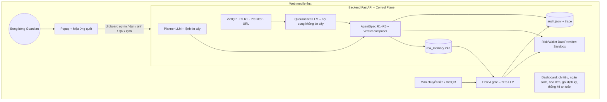

# PLAN – MoMo Guardian: Trợ lý Thanh toán An toàn (bản Web)

> Nguồn: spec gốc *MoMo Guardian — Technical Verification & Architecture Specification (v2.1)* (PDF trong repo).
> Tài liệu này là kế hoạch triển khai đã chốt với team. Spec chi tiết (requirements / design / tasks) nằm trong `.kiro/specs/momo-guardian-web/`.

## Problem Statement

Xây một trợ lý thanh toán và mua sắm dùng được thật trên web (mobile-first). Màn hình chính là dashboard quản lý tài chính. Bong bóng Guardian nổi trên mọi màn hình là điểm tương tác chính: chạm vào (hoặc tự quét khi có quyền) sẽ hiện hiệu ứng quét, sau đó trợ lý hiểu nội dung, điền sẵn thao tác và kiểm tra an toàn theo spec v2.1. Phần cần dữ liệu MoMo, NAPAS, SIMO hoặc GNN chạy bằng sandbox, có cùng interface để sau này nối dữ liệu thật. Kèm file tài liệu giải thích luồng và thuật ngữ nghiệp vụ.

## Requirements (đã chốt)

- Nộp code kèm video. Hướng tới dùng được thật, không cần tối ưu chịu tải. Team làm AI. Buổi giới thiệu sau khoảng 20 giờ; hạn nộp chính thức 03/12/2026 23:59:59 GMT+7.
- Làm web trước, mobile làm song song sau, dùng chung backend.
- LLM dùng placeholder: `MockLLM` tất định (mặc định), client Anthropic thật, Bedrock để stub. Chọn qua biến môi trường.
- Thành phần không khả thi (SIMO, GNN, NAPAS name inquiry, lịch sử giao dịch thật) đặt sau `RiskDataProvider` / `WalletDataProvider`, dùng bản Sandbox.
- Làm đủ tính năng trợ lý F1–F7 và bộ nhớ rủi ro dùng chung Flow A ↔ Flow B. Chạy xuyên đêm được.
- Màn hình chính là dashboard thống kê và quản lý. Tương tác chính qua bong bóng Guardian, có hiệu ứng quét.
- Có file `docs/FLOWS_AND_GLOSSARY.md`.

## Background (các quyết định thiết kế)

- **Hai vai LLM theo CaMeL.**
  - *Planner* (Privileged LLM) chỉ nhận lệnh do chính người dùng gõ (input tin cậy). Xuất intent đóng: `TRANSFER`, `SPLIT_BILL`, `SPEND_QUERY`, `CHECK_PROMO`, `SHOP_CHECK`, `CHECK_CONTENT`, kèm slot có giới hạn.
  - *Quarantined Extractor* nhận mọi nội dung dán vào, OCR, QR, clipboard (input không tin cậy). Không có tool, chỉ xuất enum, số, chuỗi ngắn có giới hạn.
  - Control Plane Python giữ toàn bộ quyền gọi tool và ghép verdict từ template tiếng Việt. UI không hiển thị văn bản tự do do LLM sinh ra từ dữ liệu không tin cậy.
- **F6 hỏi chi tiêu:** Planner chỉ xuất `{category enum, period enum, metric enum}`; code tất định tính kết quả, không có SQL tự do.
- **Bộ nhớ rủi ro dùng chung:** Flow B gắn cờ tài khoản/URL → lưu `risk_memory` theo session, TTL 24h. Flow A đọc và nâng lên HARD_HOLD với `RC_FLOWB_FLAGGED_RECENTLY`.
- **Trên trình duyệt:** jsQR (giải mã QR), tesseract.js `vie` (OCR), Clipboard API (opt-in), Web Speech API vi-VN (TTS).
- **Trên backend:** EMVCo + CRC, che PII, pre-filter, kiểm tra URL, LLM, policy R1–R6, Flow A, audit log.
- **Stack:** Python 3.11+, FastAPI, Pydantic v2, pytest. Web: Vite, React, TypeScript, Tailwind, Recharts, jsQR, tesseract.js, `qrcode`, Framer Motion.

## Kiến trúc

Cấu trúc repo: `backend/`, `web/`, `fixtures/`, `docs/`. Cấu hình trong `.env` (kèm `.env.example`). Không commit key.

## Thật hay Sandbox

| Thành phần | Trạng thái |
|---|---|
| VietQR EMVCo TLV + CRC-16 + UTF-8 fallback | Thật |
| OCR tiếng Việt (tesseract.js) | Thật |
| Che PII (R1), pre-filter injection, kiểm tra URL heuristic | Thật |
| CaMeL Planner/Quarantined + AgentSpec R1–R6 + audit | Thật (LLM: Mock mặc định, Anthropic qua env, Bedrock stub) |
| Calm Shield, cooling-off, TTS, Context Elicitation | Thật |
| Mã hóa lại QR để mở app ngân hàng | Thật |
| NAPAS name inquiry | Sandbox |
| SIMO, GNN mule score, fan-in velocity | Sandbox |
| Lịch sử ví, danh bạ, hóa đơn, gói định kỳ | Sandbox |
| Flow A trên giao dịch MoMo thật | Không; chạy trên màn chuyển tiền mô phỏng |
| Google Safe Browsing | Placeholder qua env |

## Task Breakdown

Ưu tiên: task 1–7 là lõi để giới thiệu. Nếu chạy xuyên đêm bị kẹt, dừng ở task 7 vẫn có demo hoàn chỉnh.

1. **Khung dự án, dữ liệu ví sandbox, dashboard, bong bóng Guardian** – FastAPI `/api/health`, `/api/wallet/summary`; `fixtures/wallet_sandbox.json` (~3 tháng giao dịch, danh bạ, hóa đơn, gói định kỳ, ngân sách); dashboard (biểu đồ danh mục, ngân sách, giao dịch gần đây, thẻ "Lá chắn"); bong bóng kéo thả, popup có hiệu ứng radar/khiên quét. Demo: dashboard có số liệu, chạm bong bóng thấy hiệu ứng quét.
2. **VietQR EMVCo (Tier 1)** – Parser TLV (00="01", 01∈{11,12}, AID A000000727, 53="704", 58="VN", Tag 54 số nguyên), CRC-16/CCITT-FALSE, Tag 62 code point → fallback UTF-8 khi CRC hợp lệ; `VALID_VIETQR` / `BAD_CRC` / `FOREIGN_OR_NON_VND` / `INVALID_FORMAT`; `fixtures/gen_qr.py`; `POST /api/qr/verify`; popup quét camera/ảnh. Test T13–T16, T28.
3. **RiskDataProvider Sandbox, Flow A, màn chuyển tiền, bộ nhớ rủi ro** – `name_inquiry`, `recipient_risk`, `payer_history`; `POST /api/flow-a/check` (ALLOW/SOFT/HARD, R4, R5, Fast Unblock, cold-start + Context Elicitation, đọc `risk_memory`, `latency_ms`); SOFT → "Kiểm tra cùng Guardian" mở Flow B. Test T23, T24, T25, T27, T31, risk memory.
4. **Che PII, CPU pre-filter, kiểm tra URL** – `redact_pii_local`, `prompt_guard_cpu_score`, URL heuristic + placeholder Safe Browsing; `POST /api/precheck`. Test T26, T18, T19, T02, T07, T12.
5. **Schema + LLMClient (Planner + Quarantined; Mock/Anthropic/Bedrock stub)** – `QuarantinedExtraction` mở rộng (`payment_request`, `receipt_items`, `listing`, `promo_claim`), `PlannerIntent`, `GuardianVerdict`, `extra="forbid"`; Mock hiểu tiếng lóng ("2 lít"=200k, "5 xị"=500k, "củ"=1tr, k, tr, ck, stk); Anthropic ép schema qua tool-use, kiểm `stop_reason`, cap 280 token; sai schema → `UNKNOWN_SUSPICIOUS`. Test T01, T03, T07, T10, T11, tiếng lóng.
6. **Policy engine R1–R6 + orchestrator Flow B** – rule theo trigger; verdict từ template; R2 abort, R3 hai mức, R6 trace; circuit breaker 4.000 ms; HARD → `risk_memory`; `POST /api/flow-b/check` trả verdict, trace, rule, thời gian stage; `audit.jsonl`; persist chỉ khi consent. Test T18–T22, T29.
7. **Popup Flow B + F1 "Dán là chuyển"** – opt-in tự quét clipboard khi mở popup / quay lại tab; dán thủ công; ảnh chụp (tesseract.js); progressive disclosure 3 stage; xác nhận hai bước; thẻ kết quả + panel "Guardian đã quyết định thế nào"; nút "Chuyển ngay" điền sẵn → Flow A; cập nhật thẻ "Lá chắn".
8. **F2 lệnh bằng câu nói, F5 khuyến mãi thật/giả, F4 mua an toàn** – F2 Planner → danh bạ sandbox (trùng tên thì hỏi lại) → chuyển tiền điền sẵn; F5 đối chiếu `fixtures/official_promos.json`; F4 so `fixtures/reference_prices.json` (rẻ ≥40% → cờ), kiểm tra URL/người bán, gợi ý COD/ví có bảo vệ. Test T04, T08, T12, các lệnh F2.
9. **F3 chia hóa đơn, F6 hỏi chi tiêu, F7 hóa đơn bất thường / gói định kỳ** – F3 OCR hóa đơn → danh sách món → gán người → VietQR cho từng người (qua `verify_vietqr_emvco`); F6 tính tất định + template + biểu đồ; F7 hóa đơn tăng ≥30% so với TB 3 tháng, gói sắp gia hạn, gói lâu không dùng.
10. **Calm Shield, cooling-off, TTS, chuyển app ngân hàng, PWA** – chữ 18–20 sp, nút "Tạm dừng & xác minh", timer; TTS vi-VN chậm; `tel:` hotline/người thân; banner "MoMo không bao giờ gọi yêu cầu chuyển tiền"; mã hóa lại QR, chặn khi HARD; PWA manifest + Web Share Target.
11. **`docs/FLOWS_AND_GLOSSARY.md` + lộ trình mobile** – sơ đồ mermaid, bảng Thật/Sandbox, thuật ngữ, danh sách RC_*; lộ trình Android share sheet, NotificationListener (opt-in), bong bóng `SYSTEM_ALERT_WINDOW`, iOS Share Extension, lý do không dùng Accessibility Service. Test: mọi RC_* trong code có trong tài liệu.
12. **Bộ kịch bản T01–T31 + A01–A12, pass^k, trang "Kịch bản demo"** – `fixtures/scenarios/`; `backend/eval/run_suite.py --runs 5 --k 3` → `eval_report.md`; trang chạy từng kịch bản / "Chạy tất cả". 100% trên MockLLM; ghi rõ độ ổn định thật phải đo lại với LLM thật.

## Evidence boundary

pass^3 = 100% trên MockLLM chỉ chứng minh Control Plane chạy đúng. Con số độ ổn định thật phải đo lại khi bật Anthropic hoặc Bedrock. Mọi số liệu latency/chi phí trong spec PDF là mô phỏng trước triển khai.