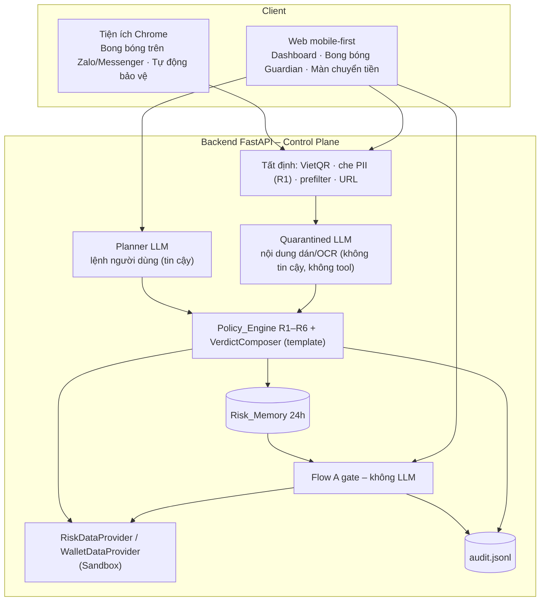

# MoMo Guardian – Trợ lý Thanh toán An toàn

Trợ lý thanh toán và mua sắm có lớp chống lừa đảo APP (Authorized Push Payment) tích hợp sẵn, dự thi **MoMo TechDay 2026** (hạng mục AI Payment Assistant & Anti-Fraud).

Người dùng không phải mở "ứng dụng chống lừa đảo". Họ dùng Guardian để chuyển tiền, chia hóa đơn, hỏi chi tiêu, kiểm tra khuyến mãi; lớp an toàn chạy bên dưới mọi thao tác đó.

> **Trạng thái:** bản trình diễn dùng được end-to-end trên web và tiện ích Chrome. Dữ liệu SIMO, GNN, NAPAS và ví là **sandbox**. LLM mặc định là `MockLLM` (luật từ khóa), xem [Bật LLM thật](#bật-llm-thật).

## Mục lục
- [Điểm nổi bật](#điểm-nổi-bật)
- [Kiến trúc](#kiến-trúc)
- [Cấu trúc repo](#cấu-trúc-repo)
- [Cài đặt và chạy](#cài-đặt-và-chạy)
- [Kịch bản trình diễn](#kịch-bản-trình-diễn)
- [Tiện ích Chrome](#tiện-ích-chrome)
- [Bật LLM thật](#bật-llm-thật)
- [Kiểm thử và eval](#kiểm-thử-và-eval)
- [Thật hay sandbox](#thật-hay-sandbox)
- [Bất biến bảo mật](#bất-biến-bảo-mật)
- [Giới hạn và lộ trình](#giới-hạn-và-lộ-trình)
- [Tài liệu](#tài-liệu)

## Điểm nổi bật

**Trợ lý thanh toán (F1–F7)**
| | Tính năng | Ví dụ |
|---|---|---|
| F1 | Dán là chuyển | Dán "ck t 2 lít vào stk 0123456789 VCB nha, tiền cơm" → form chuyển 200.000 đ điền sẵn |
| F2 | Lệnh bằng câu nói | "chuyển 200k cho Minh tiền cà phê" → tìm trong danh bạ, trùng tên thì hỏi lại |
| F3 | Chia hóa đơn | Chụp hóa đơn → tách món → mã VietQR cho từng người, tổng không lệch 1 đồng |
| F4 | Mua sắm an toàn | Bài rao rẻ hơn ≥ 40% giá tham chiếu → cảnh báo, gợi ý COD / kênh có bảo vệ người mua |
| F5 | Khuyến mãi thật hay giả | "MoMo tặng 500k, đóng phí 50k" → đối chiếu danh sách khuyến mãi chính thức |
| F6 | Hỏi chi tiêu | "tháng này cà phê hết bao nhiêu?" → con số tính tất định + biểu đồ |
| F7 | Hóa đơn bất thường | Tiền điện tăng ≥ 30% so với trung bình 3 tháng, gói sắp gia hạn, gói lâu không dùng |

**Lớp an toàn (theo spec v2.1)**
- **Flow A – cổng thanh toán không dùng LLM:** SIMO, GNN mule, tốc độ nhận tiền, chia nhỏ giao dịch theo Thông tư 50, bộ nhớ rủi ro. Đo được dưới 200 ms.
- **Flow B – kiểm tra nội dung:** che PII cục bộ (Luật 91/2025) → bộ lọc injection CPU → Quarantined LLM chỉ xuất enum/số → Policy_Engine R1–R6 tất định. Hiển thị theo từng tầng (Stage 1 < 100 ms, Stage 2 < 250 ms, cầu chì 4.000 ms).
- **VietQR:** kiểm TLV EMVCo, CRC-16/CCITT-FALSE, fallback độ dài UTF-8 cho Tag 62, chặn QR bị sửa.
- **Trung thực:** không bao giờ hiện "100% an toàn"; người nhận lần đầu không có ngữ cảnh → hỏi ngữ cảnh 1 chạm.
- **Calm Shield:** chữ lớn, nút "Tạm dừng & xác minh", đếm ngược, đọc cảnh báo bằng giọng tiếng Việt, gọi hotline.
- **Tiện ích Chrome:** bong bóng Guardian nổi trên Zalo Web, Messenger, Facebook; chạm một lần là quét khung chat đang mở.

## Kiến trúc



Sơ đồ chi tiết từng luồng, bảng thuật ngữ và đầu vào / đầu ra của người dùng nằm trong [docs/FLOWS_AND_GLOSSARY.md](docs/FLOWS_AND_GLOSSARY.md).

## Cấu trúc repo

```
backend/            FastAPI + Python
  guardian/
    api/            Router HTTP
    control_plane/  Flow A, Flow B, trợ lý, ToolRunner, grounding
    policy/         Policy_Engine R1–R6, mapping, composer, template tiếng Việt
    llm/            MockLLM, Anthropic, OpenAI-compatible, Bedrock stub, circuit breaker
    tools/          VietQR, PII, prefilter, URL, entity scanner, số tiền
    features/       Tính năng F2–F7 (danh bạ, chia bill, chi tiêu, hóa đơn, giá, khuyến mãi)
    providers/      Sandbox provider và đồng hồ
    schemas/        Pydantic (extra="forbid")
    stores/         Risk_Memory, audit, ledger, shield stats
    reason_codes.py Registry duy nhất cho mọi mã RC_*
  eval/             Eval harness pass^k
  tests/            unit, property (Hypothesis), scenarios, docs
web/                Vite + React + TypeScript + Tailwind
extension/          Tiện ích Chrome Manifest V3
fixtures/           Dữ liệu sandbox, mẫu QR, kịch bản T01–T31 và A01–A14
docs/               Luồng, thuật ngữ, đầu vào/đầu ra người dùng
.kiro/specs/        Requirements, design, tasks của dự án
```

## Cài đặt và chạy

**Yêu cầu:** Python 3.11+, Node.js 18+, Windows PowerShell (dùng `;` thay `&&` trong PowerShell 5). Trên macOS/Linux thay `.venv\Scripts\` bằng `.venv/bin/`.

```powershell
# Backend
cd backend
python -m venv .venv
.\.venv\Scripts\Activate.ps1
pip install -e ".[dev]"
Copy-Item ..\.env.example .env

# Web
cd ..\web
npm install
Copy-Item .env.example .env

# Tiện ích Chrome (tùy chọn)
cd ..\extension
npm install
npm run build
```

Chạy trong hai cửa sổ riêng:

```powershell
# Cửa sổ 1 – backend. Chạy từ trong thư mục backend/, một tiến trình (store nằm trong bộ nhớ)
cd backend
.\.venv\Scripts\Activate.ps1
uvicorn guardian.main:app --port 8000

# Cửa sổ 2 – web (proxy /api -> http://localhost:8000)
cd web
npm run dev
```

Mở địa chỉ Vite in ra (mặc định http://localhost:5173). Kiểm tra backend: `GET http://localhost:8000/api/health`.

Không commit `.env`. Khi thêm biến cấu hình, cập nhật `.env.example`.

## Kịch bản trình diễn

1. **Dashboard:** chi tiêu theo danh mục, ngân sách, hóa đơn, cảnh báo F7, thẻ "Lá chắn".
2. **Bong bóng Guardian → "Dán & kiểm tra":** sao chép tin nhắn rồi chạm một lần.
   - Tin giả công an (T01) → thẻ đỏ HARD_HOLD, Calm Shield.
   - "Chuyển gấp cho em 100k đi chị, em vừa mới đổi tài khoản…" → thẻ vàng, câu hỏi "gọi lại qua số cũ", chờ 30 giây.
   - "ck t 2 lít vào stk … VCB nha, tiền cơm" → "Chuyển ngay" mở form điền sẵn rồi qua Flow A.
3. **Màn chuyển tiền:** chuyển cho tài khoản mule → HARD_HOLD dưới 200 ms kèm "Mở chặn nhanh"; ba lần 9,8 triệu → cảnh báo chia nhỏ; người nhận mới → 4 nút hỏi ngữ cảnh.
4. **Ô lệnh:** "chuyển 200k cho Lan" → hỏi chọn Lan nào; "tháng này cà phê hết bao nhiêu?" → câu trả lời + biểu đồ.
5. **Trang `/demo`:** chạy từng kịch bản hoặc "Chạy tất cả" (không tính vào thẻ Lá chắn).
6. **Tiện ích Chrome trên `/demo-chat.html`:** chạm bong bóng → lớp quét phủ lên khung chat; bật "Tự động bảo vệ" rồi bấm "Mô phỏng tin nhắn mới".

## Tiện ích Chrome

Thư mục `extension/` (Manifest V3) đưa bong bóng Guardian lên Zalo Web, Messenger, Facebook, Telegram Web và localhost; trang khác dùng menu chuột phải hoặc **Alt+G**.

- **Chạm bong bóng khi không bôi đen:** đọc khung hội thoại đang mở (tối đa 15 tin gần nhất, bỏ thanh bên, menu, ô nhập) và cho xem lại "Guardian đã đọc N tin nhắn".
- **Bôi đen rồi chạm / chuột phải / Alt+G:** kiểm tra đúng đoạn đã chọn.
- **Tự động bảo vệ** (mặc định tắt, bật theo từng tên miền): chấm điểm tin nhắn mới ngay trong trình duyệt, gắn nhãn "Guardian: nên kiểm tra"; chỉ khi chạm nhãn nội dung mới được gửi đi.
- Gọi backend từ service worker; session id và địa chỉ backend lưu trong `chrome.storage.local`.

Cài: `cd extension; npm install; npm run build`, rồi `chrome://extensions` → bật Developer mode → **Load unpacked** → chọn `extension/dist`. Chạy backend và web, mở http://localhost:5173/demo-chat.html. Chi tiết: [extension/README.md](extension/README.md).

## Bật LLM thật

Mặc định `LLM_PROVIDER=mock`: `MockLLM` là bộ luật từ khóa phục vụ kịch bản kiểm thử, không hiểu ngôn ngữ tự do, nên tin nhắn viết kiểu lạ có thể bị bỏ sót hoặc chỉ bị đánh dấu "đáng ngờ chung chung". Các lớp tất định (QR, SIMO/GNN sandbox, URL, che PII, Policy_Engine) vẫn chạy như nhau ở mọi chế độ.

Sửa `backend/.env` rồi **khởi động lại uvicorn** (backend không tự nạp lại `.env`); kiểm tra `llm_provider` và `llm_model` ở `/api/health`.

**Anthropic**
```
LLM_PROVIDER=anthropic
ANTHROPIC_API_KEY=sk-ant-...
ANTHROPIC_MODEL=claude-haiku-4-5
```

**API tương thích OpenAI** (OpenCode, Gemini, DeepSeek, …)
```
LLM_PROVIDER=openai_compat
OPENAI_COMPAT_BASE_URL=https://opencode.ai/inference/openai/v1
OPENAI_COMPAT_API_KEY=<khóa của bạn>
OPENAI_COMPAT_MODEL=<tên model>
OPENAI_COMPAT_JSON_MODE=json_schema
```
- `OPENAI_COMPAT_JSON_MODE`: `json_schema` (mặc định), `tools` hoặc `json_object`. Nhà cung cấp báo lỗi 400 thì thử chế độ kế tiếp. Đầu ra luôn được kiểm lại bằng Pydantic; sai schema → `UNKNOWN_SUSPICIOUS` (tối đa SOFT).
- **OpenCode:** model có hậu tố `-free` chỉ chạy bên trong app OpenCode; gọi từ ứng dụng khác trả `429 FreeUsageLimitError`. Dùng model trả phí có credit hoặc gói OpenCode Go.
- **Google Gemini** (`https://generativelanguage.googleapis.com/v1beta/openai`): chọn Flash hoặc Flash-Lite để kịp cầu chì.
- **DeepSeek** (`https://api.deepseek.com`): thường dùng `json_object`.

Chọn model nhanh: cầu chì cắt sau `LLM_TIMEOUT_MS=4000` ms, quá hạn thì rơi về heuristic dự phòng (tối đa SOFT_FRICTION). Thiếu biến bắt buộc của provider đã chọn thì backend từ chối khởi động.

**Quyền riêng tư:** theo R1 chỉ văn bản đã che PII (CCCD, CMND, SĐT, OTP, tên) rời khỏi máy; OCR chạy trên thiết bị. Gói miễn phí của nhiều nhà cung cấp có thể dùng dữ liệu để huấn luyện, không dùng dữ liệu thật với các gói đó.

## Kiểm thử và eval

Chạy một lần, không watcher:

```powershell
cd backend; .venv\Scripts\python.exe -m pytest -q
cd backend; .venv\Scripts\python.exe -m eval.run_suite --runs 5 --k 3   # ghi eval_report.md
cd web; npx vitest --run; npx tsc --noEmit
cd extension; npx vitest --run; npx tsc --noEmit
```

| Bộ test | Kết quả gần nhất |
|---|---|
| Backend (unit, property Hypothesis, scenario, docs) | 634 pass |
| Web (vitest) | 113 pass, `tsc` sạch |
| Tiện ích Chrome (vitest) | 118 pass, `tsc` sạch, build OK |
| Eval pass^3, 45 kịch bản (T01–T31, A01–A14), MockLLM | 100% ở mọi nhóm |

> **Ranh giới bằng chứng:** pass^3 = 100% với MockLLM chỉ chứng minh Control Plane chạy đúng. Độ ổn định của LLM thật phải đo lại với provider thật. Mọi số latency/chi phí trong spec PDF là mô phỏng trước triển khai.

Với provider thật, đặt `GUARDIAN_DEBUG=true` để chạy được T22 và T29 (cần debug override).

## Thật hay sandbox

| Thành phần | Trạng thái |
|---|---|
| VietQR EMVCo + CRC-16 + fallback UTF-8 | Thật |
| OCR tiếng Việt (tesseract.js, chạy trên thiết bị) | Thật |
| Che PII, prefilter injection, kiểm tra URL heuristic | Thật |
| CaMeL Planner/Quarantined + AgentSpec R1–R6 + audit | Thật (LLM: Mock mặc định, Anthropic / OpenAI-compatible qua `.env`, Bedrock stub) |
| Calm Shield, cooling-off, TTS, hỏi ngữ cảnh, chia bill, hỏi chi tiêu | Thật |
| Tiện ích Chrome | Thật |
| NAPAS name inquiry, SIMO, GNN mule, fan-in | Sandbox (`fixtures/risk_sandbox.json`) |
| Lịch sử ví, danh bạ, hóa đơn, gói định kỳ | Sandbox (`fixtures/wallet_sandbox.json`) |
| Flow A trên giao dịch MoMo thật | Không; chạy trên màn chuyển tiền mô phỏng |
| Google Safe Browsing | Placeholder qua `GOOGLE_SAFE_BROWSING_API_KEY` |

Dữ liệu không khả thi đi qua interface `RiskDataProvider` / `WalletDataProvider`; MoMo chỉ cần thay bản Sandbox bằng bản nội bộ.

## Bất biến bảo mật

Chi tiết trong [CLAUDE.md](CLAUDE.md). Tóm tắt:
1. Flow A không gọi LLM.
2. Lệnh người dùng → Planner; nội dung dán/OCR/QR/clipboard → Quarantined LLM không có tool.
3. Đầu ra LLM bị ràng buộc schema; UI chỉ hiển thị text từ template tiếng Việt.
4. Chỉ nguồn tất định (SIMO, mule ≥ 0,85, fan-in, QR sai CRC, injection xác nhận, khuyến mãi giả, playbook nặng) mới tạo HARD_HOLD. Prefilter, dấu hiệu thao túng và heuristic dự phòng tối đa SOFT. LLM không bao giờ hạ được mức rủi ro.
5. Che PII trước mọi lời gọi LLM; chỉ lưu bằng chứng khi người dùng đồng ý (Luật 91/2025).
6. Không bao giờ hiện "100% an toàn"; HARD_HOLD chặn mọi chuyển sang app ngân hàng.
7. Không commit khóa API; cấu hình qua `.env`.

## Giới hạn và lộ trình

- **Điện thoại:** web không đọc được màn hình app khác. Trải nghiệm đích là app Android có bong bóng nổi (`SYSTEM_ALERT_WINDOW`), chạm vào thì chụp màn hình (MediaProjection) và OCR; iOS dùng Share Extension. Không dùng Accessibility Service.
- **Tiện ích trên site thật:** cách nhận diện khung chat mới kiểm trên trang chat giả và test tự động, chưa xác minh trên Zalo/Messenger thật.
- **LLM:** cần một provider thật chạy được; MockLLM chỉ là luật từ khóa.
- **OCR:** tesseract là OCR đa năng; bước tiếp theo là OCR tiếng Việt chuyên dụng chạy CPU trong hạ tầng tại Việt Nam làm dự phòng khi độ tin cậy thấp.
- **Dữ liệu rủi ro:** cần tích hợp SIMO/GNN/NAPAS nội bộ thay cho sandbox.

## Tài liệu

- [docs/FLOWS_AND_GLOSSARY.md](docs/FLOWS_AND_GLOSSARY.md) – luồng, đầu vào/đầu ra người dùng, thuật ngữ, toàn bộ mã RC_*, lộ trình mobile.
- [.kiro/specs/momo-guardian-web/](.kiro/specs/momo-guardian-web/) – requirements, design, tasks.
- [PLAN.md](PLAN.md) – kế hoạch triển khai ban đầu.
- [CLAUDE.md](CLAUDE.md) – hướng dẫn và bất biến cho AI agent.
- [eval_report.md](eval_report.md) – báo cáo eval gần nhất.
- Spec nghiên cứu gốc: `MoMo Guardian — Technical Verification & Architecture Specification (v2.1).pdf`.
