# Luồng xử lý và thuật ngữ – MoMo Guardian

Tài liệu mô tả các luồng nghiệp vụ, ranh giới Thật / Sandbox, thuật ngữ, danh sách `Reason_Code` và `Stop_Code`, cùng lộ trình mobile. Định danh code giữ nguyên tiếng Anh. Nguồn sự thật cho policy là `.kiro/specs/momo-guardian-web/`; danh sách mã lấy từ `backend/guardian/reason_codes.py` (`REGISTRY`).

## 1. Tổng quan

MoMo Guardian là trợ lý thanh toán và mua sắm có lớp chống lừa đảo APP (Authorized Push Payment). Bản hiện tại là web mobile-first, dùng chung backend với app mobile sau này.

- **Flow A** là cổng chặn lúc chuyển tiền. Không gọi LLM; chỉ dùng luật, điểm rủi ro, SIMO/GNN (sandbox) và `risk_memory`.
- **Flow B** là luồng kiểm tra nội dung người dùng dán, OCR, QR, clipboard. Nội dung này là UNTRUSTED và chỉ đi vào Quarantined LLM. Control Plane Python giữ quyền gọi tool và ghép verdict từ template tiếng Việt.
- **Risk_Memory** nối hai luồng: Flow B gắn cờ tài khoản/URL, Flow A đọc cờ đó.
- **Tính năng F1–F7** là các trợ lý xây trên cùng lõi an toàn.
- Guardian không bao giờ hiển thị "100% an toàn" (honesty invariant).

## Người dùng đưa vào gì, nhận lại gì
Mục này dành cho người không làm kỹ thuật (giám khảo, người làm sản phẩm). Mọi nhãn, nút và câu chữ bên dưới lấy từ giao diện và backend thật (`web/src`, `extension/src`, `backend/guardian/reason_codes.py`, `policy/ui_hints.py`, `policy/templates_vi.py`). Ba phần chính: bảng **Điểm vào** (đưa gì vào), bảng **Kết quả người dùng thấy** (nhận lại gì theo từng mức), các khối theo từng luồng, rồi một **Ví dụ đầu–cuối**.
Nguyên tắc chung: mọi câu chữ người dùng đọc đều đến từ template tiếng Việt cố định, không phải văn bản do LLM tự viết. Dữ liệu ví, danh bạ, tên chủ tài khoản, SIMO/GNN là **sandbox** (giao diện hiện nhãn "Sandbox" khi có).
### Điểm vào
| Điểm vào | Người dùng làm gì (đầu vào) | Guardian đọc gì | Dữ liệu rời khỏi thiết bị | Người dùng nhận lại gì |
|---|---|---|---|---|
| Web popup, nút **"Dán & kiểm tra"** | Sao chép tin nhắn ở app khác, mở Guardian, chạm một lần (không cần nhấn giữ để dán). | Nội dung clipboard, đọc đúng một lần ngay khi chạm (origin `CLIPBOARD`). | Text (tối đa 4.000 ký tự) gửi tới backend `/api/flow-b/check`. Backend che PII (CCCD, SĐT, OTP, tên) trước; LLM chỉ nhận text đã che. | Thẻ kết quả theo tier. Nếu trình duyệt chặn clipboard hoặc clipboard trống: thông báo "Bạn hãy dán nội dung vào ô bên dưới". |
| Web popup, **ô dán** ("Dán nội dung cần kiểm tra") + nút **"Kiểm tra nội dung"** | Dán tin nhắn, đường dẫn hoặc thông tin chuyển khoản, bấm "Kiểm tra nội dung". | Đúng đoạn đã dán (origin `PASTE`). | Như dòng trên. | Như dòng trên. |
| Tự kiểm tra clipboard (tùy chọn) | Bật công tắc **"Kiểm tra clipboard"** (mặc định tắt). | Clipboard, đọc một lần khi mở Guardian hoặc khi quay lại tab; không đọc định kỳ; bỏ qua nội dung đã đọc rồi (dedupe). | Như dòng "Dán & kiểm tra", nhưng chỉ khi đã bật công tắc. | Thẻ kết quả. Nếu chưa bật công tắc thì Guardian không đọc gì. |
| **Ảnh / ảnh chụp màn hình** (nút "Chọn / chụp ảnh") | Chụp hoặc chọn ảnh tin nhắn, hóa đơn, màn hình chuyển khoản. | Chữ trong ảnh, nhận dạng OCR tiếng Việt **ngay trên thiết bị** (tesseract.js). | Chỉ phần chữ đã nhận dạng gửi đi (origin `OCR`), ảnh không rời máy. | Thẻ kết quả. Nếu có số tài khoản: bước **"Xác nhận người nhận"** (xem Name confirmation). Ảnh không đọc được: "Guardian chưa đọc được chữ trong ảnh…" kèm gợi ý dán tay. |
| **QR** (nút "Quét QR": camera, hoặc chọn ảnh chứa QR) | Đưa mã QR vào camera hoặc chọn ảnh. | Chuỗi payload VietQR giải mã **trên thiết bị** (origin `QR_CAMERA` hoặc `QR_IMAGE`); backend kiểm EMVCo TLV + CRC-16. | Chỉ chuỗi payload QR gửi tới backend. | Thẻ kết quả; QR bị sửa (sai CRC) cho thẻ đỏ. Không thấy QR: "Chưa thấy mã QR nào…". |
| **Ô lệnh** ("Hoặc gõ lệnh", F2/F6; ví dụ "chuyển cho Lan 2 lít") | Gõ một câu lệnh ngắn (tối đa 200 ký tự), bấm "Gửi". | Câu lệnh do chính người dùng gõ (TRUSTED), chỉ vào Planner, Planner chỉ trả enum ý định. Nội dung dán vào ô lệnh bị coi là nội dung lạ và đi Flow B. | Câu lệnh gửi tới backend; không gửi dữ liệu nào khác. | Điền sẵn giao dịch, hỏi chọn người nhận, hỏi số tiền, câu trả lời chi tiêu có biểu đồ, hoặc mở chế độ chia hóa đơn / mua hàng (xem F2, F3, F6). |
| **"Kiểm tra cùng Guardian"** (từ màn chuyển tiền, mức SOFT_FRICTION) | Bấm nút khi Guardian cảnh báo; chia sẻ ảnh chụp đoạn chat. | Nội dung chat gắn với giao dịch đang chờ (origin `CONTEXT_CHAT` nếu là ảnh, OCR trên thiết bị). | Text sau OCR gửi tới backend, kèm mã giao dịch đang kiểm. | Thẻ kết quả Flow B; nếu tìm thấy dấu hiệu HARD, cờ được ghi cho Flow A (xem Risk memory). |
| **Chia sẻ vào Guardian** (share target, PWA Android) | Từ app khác chọn Chia sẻ, chọn Guardian. | Tiêu đề + nội dung + liên kết gộp thành một khối text (origin `SHARE_TARGET`). | Text gộp gửi tới backend; hộp nhận chia sẻ được xóa sau khi đọc. | Guardian mở và tự chạy kiểm tra, trả thẻ kết quả. |
| **Tiện ích Chrome: chạm bong bóng, có bôi đen** | Bôi đen tin đáng ngờ, chạm bong bóng nổi. | Đúng đoạn bôi đen (origin `EXTENSION_SELECTION`). | Đoạn bôi đen (tối đa 4.000 ký tự) tới backend đã cấu hình; che PII ở backend. | Bảng kết quả ngay trên trang (nhãn theo tier, gạch đầu dòng, câu hỏi, đếm giờ). |
| **Tiện ích Chrome: chạm bong bóng, không bôi đen** | Chỉ chạm bong bóng. | Guardian xác định **khung hội thoại chính** (vùng cuộn, nằm trong khung nhìn, chứa nhiều khối tin) và lấy tối đa **15 tin nhắn gần nhất**, tổng không quá 4.000 ký tự (origin `EXTENSION_PAGE_TEXT`). Bỏ qua thanh bên, danh sách cuộc trò chuyện, thanh điều hướng, ô nhập, mốc thời gian và giao diện Guardian. | Chỉ các tin nhắn đó, và chỉ sau khi người dùng chạm. | Dòng **"Guardian đã đọc N tin nhắn"** kèm danh sách tin để người dùng rà lại, rồi bảng kết quả. |
| Tiện ích: **menu chuột phải** "Kiểm tra bằng MoMo Guardian" | Bôi đen, bấm chuột phải, chọn mục menu. | Đoạn bôi đen (như bong bóng có bôi đen). | Như dòng bong bóng có bôi đen. | Như trên. |
| Tiện ích: phím tắt **Alt+G** | Bấm Alt+G (bôi đen hoặc không). | Như bong bóng: bôi đen thì đọc đoạn bôi đen, không thì đọc khung hội thoại chính. | Như bong bóng. | Như trên. |
| Tiện ích: **Tự động bảo vệ** (nhãn "Guardian: nên kiểm tra") | Bật công tắc "Tự động: Bật" dưới bong bóng, riêng từng trang (mặc định tắt). | Tin nhắn mới xuất hiện trên trang, chấm điểm **ngay trong trình duyệt** bằng luật cục bộ. | **Không gửi gì** cho tới khi người dùng bấm nhãn; bấm thì chỉ gửi đúng tin nhắn đó. Chỉ lưu tên miền đã bật, không lưu nội dung. | Nhãn nhỏ "Guardian: nên kiểm tra" cạnh tin đáng ngờ (chưa phải kết luận). Bấm nhãn mới ra kết quả. |
Ghi chú: lưu bằng chứng mặc định tắt (công tắc **"Cho phép lưu bằng chứng"**). Khi tắt, Guardian chỉ lưu mã băm của nội dung, không lưu nội dung (Luật 91/2025).
### Kết quả người dùng thấy
| | ALLOW | SOFT_FRICTION | HARD_HOLD |
|---|---|---|---|
| Màu thẻ | Xanh lá | Hổ phách (amber) | Đỏ |
| Nhãn trên web | "Chưa thấy dấu hiệu bất thường" | "Cần kiểm tra thêm trước khi chuyển" | "Guardian đã tạm giữ giao dịch này" |
| Nhãn trên tiện ích | "Chưa thấy dấu hiệu bất thường" | "Có dấu hiệu đáng ngờ, cần kiểm tra thêm" | "Rất có dấu hiệu lừa đảo, đừng chuyển tiền" |
| Gạch đầu dòng (bằng chứng) | Tối đa 4 (3 trong Calm Shield). Ví dụ: "Bạn đã từng chuyển tiền cho người nhận này." | Tối đa 4 (3 trong Calm Shield). Ví dụ `RC_ACCOUNT_SWAP_REQUEST`. | Tối đa 4 (3 trong Calm Shield). Ví dụ `RC_AUTHORITY_COERCION`. |
| Câu hỏi System 2 | Không | Tối đa 2, theo kịch bản (người thân, cơ quan, đổi tài khoản, vùng xám). Trả lời "Rồi" hoặc "Chưa". Trên web hiện ở cổng chờ của màn chuyển tiền; trên tiện ích hiện trong khối "Hãy tự hỏi trước khi chuyển tiền". | Có thể có (tối đa 2), cùng cách hiển thị. |
| Thời gian chờ (cooling-off) | 0 giây | 15, 30 hoặc 60 giây tùy mã lý do (lấy mức cao nhất). Nút "Tiếp tục chuyển tiền" bị khóa tới khi hết giờ **và** đã trả lời hết câu hỏi. Tiện ích hiện "Hãy chờ ít nhất 30 giây và hỏi lại người thân trước khi quyết định." | 60 giây. |
| **"Chuyển ngay"** | Hiện khi đã đủ BIN, số tài khoản, số tiền (`show_transfer_now`). | Hiện trong popup khi prefill đủ; ở màn chuyển tiền, đi qua cổng chờ và nút "Tiếp tục chuyển tiền". | **Ẩn**. |
| **"Mở chặn nhanh"** | Ẩn | Ẩn | Chỉ hiện khi `allow_fast_unblock` (xem Flow A). |
| **"Chuyển sang app ngân hàng"** / "Mở app ngân hàng" | Có | Có | **Chặn**: "Guardian đang tạm giữ giao dịch này nên không xuất mã QR sang app ngân hàng." |
| **"Kiểm tra cùng Guardian"** | Ẩn | Hiện (màn chuyển tiền) | Ẩn |
| **"Tạm dừng & xác minh"**, gọi hotline | Chỉ khi Calm Shield bật | Chỉ khi Calm Shield bật | Chỉ khi Calm Shield bật |
Quy tắc trung thực (honesty invariant):
- Guardian không bao giờ viết "100% an toàn". Nhãn ALLOW chỉ nói "Chưa thấy dấu hiệu bất thường", và bullet ALLOW nhắc người dùng tự kiểm tra tên người nhận. Tiện ích còn ghi: "Kết quả chỉ để tham khảo. Hãy xác minh qua kênh chính thức trước khi chuyển tiền."
- **Kết quả tạm của Stage 2** không bao giờ hiện nhãn tier. Chỉ có hai khả năng: dòng trung tính **"Đang phân tích tiếp…"**, hoặc cảnh báo đỏ ("Cảnh báo đỏ: Guardian thấy dấu hiệu nghiêm trọng ở mã QR hoặc tài khoản nhận. Đừng chuyển tiền."). Tiện ích hiện "Phát hiện dấu hiệu đáng ngờ. Đang phân tích sâu hơn…" hoặc "Cảnh báo: phát hiện dấu hiệu rủi ro cao. Đang phân tích sâu hơn…".
- Lỗi hoặc mất kết nối không bao giờ trông giống ALLOW: web hiện "Chưa có kết luận, hãy thử lại"; tiện ích hiện "Chưa kiểm tra được… Đừng chuyển tiền nếu bạn còn nghi ngờ."
- Nếu LLM chậm hoặc lỗi, Guardian dùng kiểm tra nhanh và hiện mức SOFT_FRICTION kèm bullet nói rõ phân tích AI chưa đầy đủ.
### Đầu vào và đầu ra theo từng luồng
**Flow A: chuyển tiền (không dùng LLM).**
| Bước | Người dùng làm | Guardian trả |
|---|---|---|
| 1 | Nhập hoặc nhận điền sẵn **Mã ngân hàng (BIN)**, **Số tài khoản**, **Số tiền**, **Lời nhắn** (điền sẵn từ F1, F2, QR, danh bạ). | Màn "Xác nhận chuyển tiền" liệt kê lại 4 trường. |
| 2 | Bấm **"Kiểm tra thông tin"**, đọc lại, rồi **"Xác nhận chuyển"** (hoặc "Sửa thông tin"). | Gọi Flow A một lần, trả verdict theo bảng "Kết quả người dùng thấy". |
| 3 | Người nhận lần đầu và chưa có tín hiệu rủi ro (`RC_COLD_START_NEEDS_CONTEXT`, SOFT, 0 giây). | Hộp **"Bạn chuyển tiền này vì lý do gì?"** với 4 nút một chạm (bảng dưới) và nút "Chia sẻ ảnh chụp đoạn chat để Guardian xem giúp". |
| 4 | Nếu HARD_HOLD cho phép mở chặn: bấm **"Mở chặn nhanh"**. | Hộp nhập **Mã OTP (mô phỏng)** và chọn **Mục đích chuyển tiền** (Gửi tiền cho người nhà, Thanh toán hàng hóa dịch vụ, Tiền thuê nhà, Học phí, Trả nợ vay, Thanh toán kinh doanh, Mục đích khác), nút "Xác thực" và "Hủy". Đúng mã thì verdict mới là SOFT_FRICTION `RC_FAST_UNBLOCK_VERIFIED`: "Bạn đã xác minh danh tính và mục đích. Hãy chờ hết thời gian rồi kiểm tra lại người nhận." (30 giây). Sai mã: "Mã xác thực chưa đúng. Bạn kiểm tra lại rồi thử nhé." |
| 5 | Qua đủ giờ chờ và câu hỏi, bấm "Tiếp tục chuyển tiền" (hoặc "Chuyển ngay" ở mức ALLOW). | "Đã mô phỏng chuyển … Đây là dữ liệu mô phỏng, không có tiền thật được chuyển." |
Bốn nút ngữ cảnh khi cold-start:
| Nút | Verdict mới | Giờ chờ | Ghi chú |
|---|---|---|---|
| **Mua tại cửa hàng** | ALLOW, `RC_CONTEXT_IN_STORE_DECLARED`: "Bạn xác nhận đang thanh toán trực tiếp tại cửa hàng." | 0 | Bỏ tầng SOFT của cold-start. |
| **Đơn hàng online** | SOFT, `RC_CONTEXT_ONLINE_ORDER_DECLARED`: "Bạn cho biết đây là đơn hàng online. Hãy dùng kênh thanh toán có bảo vệ người mua." | 15 | Hiện gợi ý thanh toán an toàn (COD, kênh có bảo vệ người mua, không đặt cọc cho người lạ). |
| **Người thân nhờ gấp** | SOFT, `RC_CONTEXT_RELATIVE_URGENT_DECLARED`: "Bạn cho biết đây là chuyển gấp cho người thân. Hãy gọi lại số quen trước khi chuyển." | 30 | 2 câu hỏi: đã gọi lại bằng số quen chưa; tài khoản nhận có đúng của người thân không. |
| **Cơ quan chức năng yêu cầu** | SOFT, `RC_CONTEXT_AUTHORITY_DECLARED`: "Bạn cho biết cơ quan nhà nước yêu cầu chuyển tiền. Cơ quan thật không làm vậy qua ví." | 60 | 2 câu hỏi về yêu cầu "xác minh" và đã gọi đường dây nóng chưa. Bật **Calm Shield**. |
Nếu verdict không có cold-start, backend từ chối với "Giao dịch này không cần bổ sung ngữ cảnh."
**Flow B: kiểm tra nội dung (Stage 1, 2, final).**
| Giai đoạn | Điều xảy ra | Người dùng thấy |
|---|---|---|
| Stage 0 và 1 | Che PII, pre-filter injection, kiểm URL; Quarantined LLM trích thông tin có schema (không có quyền gọi tool). | Hoạt ảnh quét. |
| Stage 2 (tạm) | Tín hiệu nhanh từ QR và tài khoản nhận. | Chỉ "Đang phân tích tiếp…" hoặc cảnh báo đỏ, không có nhãn tier. |
| Final | Control Plane ghép verdict từ template tiếng Việt, có ngưỡng 4.000 ms (circuit breaker). | Thẻ kết quả đầy đủ, các nút theo bảng trên, và mục thu gọn "Guardian đã quyết định thế nào" (bước, thời gian, luật đã kích hoạt). Nếu kết nối đứt giữa chừng: "Chưa có kết luận, hãy thử lại." |
Nếu nội dung có đủ BIN, số tài khoản và số tiền thì thẻ có nút **"Chuyển ngay"** (mở màn chuyển tiền đã điền sẵn; thiếu trường nào sẽ hỏi trường đó: "Bổ sung thông tin còn thiếu để chuyển") và **"Chuyển sang app ngân hàng"**. Với mức HARD_HOLD, nút "Chuyển ngay" ẩn và nút app ngân hàng bị chặn.
**Name confirmation (xác nhận tên người nhận khi số tài khoản đến từ OCR).**
| Người dùng thấy | Hành động | Kết quả |
|---|---|---|
| "Guardian đọc được tài khoản từ ảnh. Bạn kiểm tra lại nhé." + tên ngân hàng + dãy số tách từng chữ số (ví dụ `0 3 7 8 5 8 2 0 8 5`) + tên chủ tài khoản (sandbox) hoặc "Không tìm thấy tên chủ tài khoản" | **"Đúng người nhận"** | Guardian tiếp tục kiểm tra người nhận. Trong lúc chờ xác nhận, nút "Chuyển ngay" bị ẩn. |
| (như trên) | **"Sai, sửa số"**, nhập "Số tài khoản đúng", bấm **"Tra lại"** | Tra lại với số đã sửa. |
Mã `RC_OCR_ACCOUNT_NEEDS_CONFIRM`: "Số tài khoản đọc từ ảnh cần bạn xác nhận tên người nhận trước." Guardian không tra người nhận khi OCR chưa được xác nhận (luật R2).
**F1 – "Dán là chuyển".**
| Đầu vào | Guardian làm | Đầu ra |
|---|---|---|
| Dán "ck t 2 lít vào stk 0123456789 VCB nha, tiền cơm" | PII_Redactor giữ số tài khoản đi kèm "stk" hoặc tên ngân hàng; trích `payment_request`: "2 lít" thành 2.000.000 VND, "VCB" thành BIN `970436` (Vietcombank), số tài khoản `0123456789`, lời nhắn "tiền cơm". | Thẻ kết quả theo tier, kèm nút "Chuyển ngay" điền sẵn BIN, số tài khoản, số tiền, lời nhắn và "Chuyển sang app ngân hàng". Cần xác nhận hai bước ở màn chuyển tiền; thiếu trường thì hỏi bổ sung. |
**F2 – Lệnh bằng câu nói.**
| Đầu vào (ô lệnh) | Đầu ra |
|---|---|
| "chuyển 200k cho Minh tiền cà phê" (danh bạ sandbox có đúng một người tên Minh) | "Đã điền sẵn giao dịch 200.000 đ cho <tên trong danh bạ>. Bạn kiểm tra lại rồi xác nhận nhé." và mở màn chuyển tiền điền sẵn. |
| "chuyển cho Bảo" (thiếu số tiền) | "Bạn muốn chuyển bao nhiêu cho <tên>?" |
| "chuyển cho Lan 2 lít" (danh bạ sandbox có hai người tên Lan) | "Có 2 người tên "Lan" trong danh bạ. Bạn chọn đúng người nhận nhé." kèm danh sách chọn, mỗi dòng hiện 4 số cuối tài khoản. |
| Tên không có trong danh bạ | "Guardian không tìm thấy "…" trong danh bạ. Bạn nhập số tài khoản và ngân hàng để chuyển nhé." |
| Câu không hiểu | "Guardian chưa hiểu yêu cầu này. Bạn thử diễn đạt lại theo các ví dụ dưới đây nhé." kèm ví dụ. |
**F3 – Chia hóa đơn.** Đầu vào: chụp hoặc dán hóa đơn (hoặc lệnh "chia hóa đơn lẩu cho 3 người", mở chế độ chia hóa đơn). Đầu ra: danh sách món có thể sửa (tên, số lượng 1–99, đơn giá), tổng trên hóa đơn, danh sách người cùng chia, chọn **"Chia đều"** hoặc **"Gán theo món"**, bấm **"Tính phần mỗi người"**. Tổng các món lệch tổng hóa đơn thì hiện "Tổng các món chưa khớp với tổng hóa đơn" và yêu cầu sửa. Khớp thì mỗi người nhận một thẻ có mã VietQR chuyển về tài khoản mô phỏng của người trả ("Phần của bạn, không cần chuyển." cho chính người trả). OCR chạy trên thiết bị.
**F4 – Mua sắm an toàn.** Đầu vào: tin rao bán hoặc ảnh sản phẩm ("Chế độ kiểm tra mua hàng"). Đầu ra: thẻ **"Giá món hàng"** gồm "Giá rao", "Giá tham chiếu", "Rẻ hơn tham chiếu"; rẻ hơn từ 40% trở lên là SOFT với "Giá rao thấp hơn giá tham chiếu từ 40% trở lên."; chưa có giá thì "Chưa có giá tham chiếu"; liên kết rủi ro là `RC_RISKY_URL_DETECTED`. Khi có dấu hiệu đặt cọc, khối **"Cách thanh toán an toàn hơn"** hiện 3 gợi ý (COD, kênh có bảo vệ người mua, tránh đặt cọc cho người chưa xác minh).
**F5 – Khuyến mãi thật hay giả.** Đầu vào: nội dung khuyến mãi ("Chế độ kiểm tra khuyến mãi"). Đầu ra: thẻ **"Khuyến mãi của …"**. Khớp danh sách chính thức thì ALLOW ("Nội dung khớp với khuyến mãi chính thức Guardian đang có."). Không khớp thì SOFT ("Khuyến mãi này không có trong danh sách chính thức Guardian đang có."). Đòi phí trước để nhận thì HARD (`RC_FAKE_PROMO_REFUND`, `RC_BRAND_IMPERSONATION_MOMO`). Trong Calm Shield, thẻ khuyến mãi bị ẩn.
**F6 – Hỏi chi tiêu.** Đầu vào (ô lệnh): "tháng này cà phê hết bao nhiêu?" hoặc "tuần trước đi grab mấy lần?". Đầu ra: một câu trả lời mẫu, ví dụ "Tháng này bạn đã chi X cho cà phê (N giao dịch).", kèm biểu đồ theo ngày hoặc tuần, dòng "Tăng/Giảm X% so với kỳ trước" và "Dữ liệu ví mô phỏng (sandbox)." Phép tính do code tất định thực hiện, không để LLM tự tính. Không có dữ liệu: "Chưa có giao dịch trong khoảng thời gian này."
**F7 – Hóa đơn bất thường và gói định kỳ.** Không có đầu vào; Guardian tự đọc ví sandbox. Đầu ra là mục **"Cảnh báo"** trên Tổng quan: "Hóa đơn tăng" (đỏ; tăng từ 30% so với trung bình 3 kỳ, ví dụ "Hóa đơn … tăng X% so với trung bình 3 kỳ (…)"), "Sắp gia hạn" (vàng; ngày gia hạn và số tiền), "Gói ít dùng" (xanh; "chưa dùng trong N ngày", kèm gợi ý cân nhắc hủy gói). Không có gì: "Không có cảnh báo nào."
**Calm Shield (chế độ trấn an).**
| Khi nào bật (`ui_hints.calm_shield`) | Thay đổi trên màn hình |
|---|---|
| Nội dung có dấu hiệu hối thúc hoặc dặn giữ bí mật; hoặc verdict khác ALLOW và đang trong khung 23:00–05:00 (GMT+7); hoặc người dùng chọn "Cơ quan chức năng yêu cầu". | Banner đen "MoMo không bao giờ gọi điện yêu cầu bạn chuyển tiền"; chữ lớn, viền đậm, tối đa 3 gạch đầu dòng, ẩn thẻ khuyến mãi; nút chính **"Tạm dừng & xác minh"** (bấm thì hiện "Bạn chưa cần làm gì thêm. Hãy gọi người thân hoặc tổng đài để xác minh trước khi chuyển tiền."); nút gọi **"Gọi tổng đài …"** và **"Gọi <tên người thân>"**; nút **"Đọc to cho tôi nghe"** (giọng tiếng Việt, đọc banner và bullet); nút mờ **"Tôi đã hiểu, tiếp tục"** để quay lại bố cục thường. Trên tiện ích: banner, nhãn, bullet, "Gọi tổng đài …", "Mở MoMo Guardian", "Đóng". |
**Bank handoff (mở app ngân hàng).** Nút **"Chuyển sang app ngân hàng"** tạo mã VietQR đã điền sẵn từ BIN, số tài khoản, số tiền, lời nhắn ("Đang tạo mã QR…"), hiện ảnh QR kèm **"Tải mã QR"** và **"Mở app ngân hàng"**. Với HARD_HOLD, nút không tạo mã và hiện "Guardian đang tạm giữ giao dịch này nên không xuất mã QR sang app ngân hàng." Guardian không chuyển tiền thật; app ngân hàng mới là nơi tiền đi.
**Risk memory (Flow B nhớ cho Flow A).** Khi Flow B kết luận HARD_HOLD cho một tài khoản hoặc URL, cờ được ghi theo phiên trong 24 giờ. Nếu cùng phiên sau đó người dùng chuyển tiền tới đúng tài khoản đó, Flow A trả thẻ đỏ với `RC_FLOWB_FLAGGED_RECENTLY`: "Guardian vừa cảnh báo tài khoản này trong nội dung bạn kiểm tra gần đây." Hết 24 giờ hoặc khác phiên thì cờ không còn.
**Tổng quan (dashboard) và Lá chắn.**
| Khối | Con số hoặc nội dung nghĩa là gì |
|---|---|
| **"Guardian đã bảo vệ bạn"** (Lá chắn) | **Số lần kiểm tra** là số verdict Guardian đã ra trong phiên hiện tại, cả Flow A lẫn Flow B. Ba dòng đếm theo mức: **Cho phép** (ALLOW), **Cần cân nhắc** (SOFT_FRICTION), **Tạm giữ** (HARD_HOLD). Chạy từ trang Kịch bản demo không được tính. |
| Giao dịch gần đây, Ngân sách tháng này, Hóa đơn và gói định kỳ, biểu đồ chi tiêu | Dữ liệu ví **sandbox**, có nhãn Sandbox. |
| Cảnh báo | Kết quả F7 (xem trên). |
**Trang Kịch bản demo.** Danh sách kịch bản (mã như T01, A01) kèm mô tả, "Mong đợi: …", nút **"Chạy"** từng kịch bản hoặc **"Chạy tất cả"**; kết quả "Đạt" hoặc "Không đạt" với "Thực tế: tier · mã lý do", tổng "Đạt x/y". Một số kịch bản cần bật `GUARDIAN_DEBUG` ở backend. Kết quả không tính vào Lá chắn, dữ liệu là sandbox.
### Ví dụ đầu–cuối
**Ví dụ 1: tin nhắn "em mới đổi tài khoản".** Người dùng nhận tin: "Chuyển gấp cho em 100k đi chị, em vừa mới đổi tài khoản nên chuyển vào tài khoản này nhé : 0378582085 tpbank".
1. Người dùng sao chép tin, mở Guardian, chạm **"Dán & kiểm tra"** (hoặc bôi đen tin và chạm bong bóng trên máy tính).
2. Màn hình hiện hoạt ảnh quét và dòng trung tính "Đang phân tích tiếp…" (chưa có nhãn tier).
3. Kết quả: thẻ **hổ phách** (SOFT_FRICTION), nhãn "Cần kiểm tra thêm trước khi chuyển" (tiện ích: "Có dấu hiệu đáng ngờ, cần kiểm tra thêm").
4. Bullet từ `RC_ACCOUNT_SWAP_REQUEST`: "Tin nhắn nhờ bạn chuyển tiền vào một tài khoản mới hoặc khác tài khoản cũ. Kẻ gian hay dùng chiêu này." (có thể kèm bullet về hối thúc).
5. Câu hỏi System 2 (câu gọi lại): "Bạn đã gọi điện hoặc gọi video cho người này qua số điện thoại cũ để xác minh chưa?"
6. Thời gian chờ **30 giây**: nút tiếp tục bị khóa tới khi hết giờ và đã trả lời "Rồi" hoặc "Chưa".
7. Guardian điền sẵn TPBank (BIN `970423`), số tài khoản `0378582085`, số tiền 100.000 đ. "Chuyển ngay" và "Chuyển sang app ngân hàng" vẫn dùng được sau bước xác nhận hai bước, vì đây là mức SOFT, không phải HARD.
**Ví dụ 2: mạo danh công an.** Người dùng nhận: "Đây là Công an quận 1, tài khoản VNeID của bạn liên quan đường dây rửa tiền, chuyển 50tr vào stk 1903777888999 TCB để xác minh, không được nói với ai".
1. Cùng cách đưa vào (dán, chia sẻ hoặc bong bóng).
2. Kết quả: thẻ **đỏ** (HARD_HOLD), nhãn "Guardian đã tạm giữ giao dịch này" (tiện ích: "Rất có dấu hiệu lừa đảo, đừng chuyển tiền").
3. Bullet từ `RC_AUTHORITY_COERCION`: "Công an và cơ quan nhà nước không yêu cầu chuyển tiền qua ví hay qua điện thoại."
4. Calm Shield bật vì có dấu hiệu hối thúc và giữ bí mật: banner "MoMo không bao giờ gọi điện yêu cầu bạn chuyển tiền", "Tạm dừng & xác minh", "Gọi tổng đài …".
5. Thời gian chờ 60 giây. **"Chuyển ngay"** ẩn; "Chuyển sang app ngân hàng" bị chặn, không xuất mã QR.
6. Guardian ghi cờ Risk memory 24 giờ cho tài khoản `1903777888999`. Nếu người dùng vẫn thử chuyển cho tài khoản này trong cùng phiên, Flow A trả HARD_HOLD `RC_FLOWB_FLAGGED_RECENTLY`.
## 2. Kiến trúc tổng thể

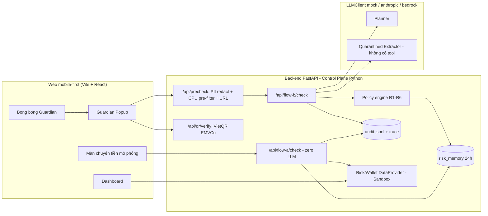

## 3. Flow A – cổng chặn lúc thanh toán (không LLM)

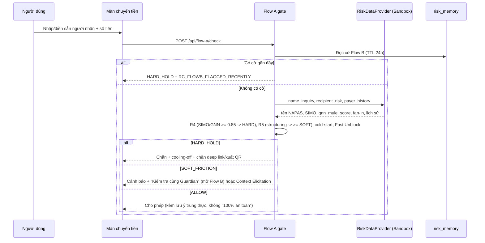

## 4. Flow B – kiểm tra nội dung (progressive disclosure, circuit breaker)

```mermaid
flowchart TD
  IN[Nội dung dán / OCR / QR / clipboard] --> S0[Stage 0: PII redact R1 + CPU pre-filter + URL heuristic]
  S0 -->|Phát hiện injection| HARD0[HARD_HOLD RC_PROMPT_INJECTION_BLOCKED]
  S0 --> S1[Stage 1: Quarantined Extractor trích xuất có schema]
  S1 -->|Sai schema / stop_reason lạ| UNK[UNKNOWN_SUSPICIOUS]
  S1 --> S2[Stage 2: Policy R1-R6 + tool do Control Plane gọi]
  S2 --> CB{Circuit breaker 4.000 ms}
  CB -->|Quá hạn| FB[Fallback RC_LLM_TIMEOUT_FALLBACK -> SOFT_FRICTION]
  CB -->|Đúng hạn| V[Verdict từ template tiếng Việt]
  UNK --> V
  FB --> V
  V -->|HARD| RMW[Ghi risk_memory]
  V --> UI[Thẻ kết quả + panel "Guardian đã quyết định thế nào"]
  UI --> CONF[Xác nhận hai bước] --> A[Điền sẵn -> Flow A]
```

Progressive disclosure: UI hiển thị theo ba stage (tiền kiểm CPU, trích xuất, quyết định), kết quả sớm hiện trước, chi tiết mở rộng khi người dùng muốn xem. Circuit breaker cắt Stage 2 sau 4.000 ms và rơi về fallback thay vì treo giao dịch.

## 5. QR 3-tier cascade

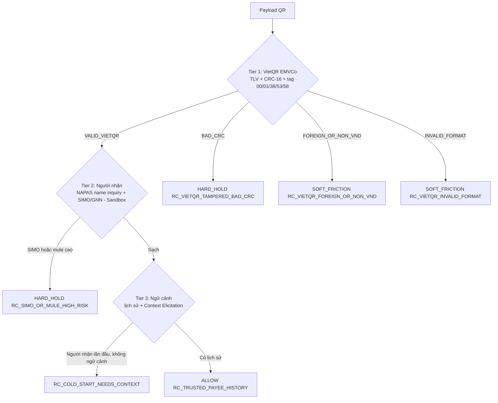

## 6. CaMeL – vai Planner và Quarantined

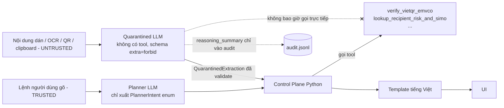

## 7. Risk_Memory – chuyển giao Flow B sang Flow A

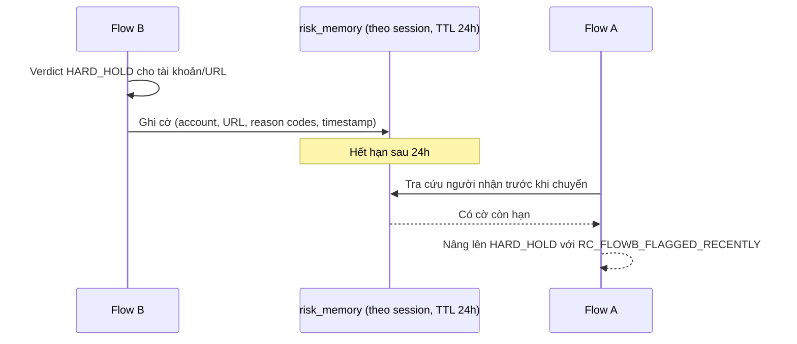

## 8. Các tính năng F1–F7

### F1 – "Dán là chuyển"

```mermaid
flowchart LR
  P[Dán tin / ảnh chụp / clipboard opt-in] --> OCR[tesseract.js nếu là ảnh]
  OCR --> B[Flow B: Quarantined trích payment_request]
  P --> B
  B --> V{Verdict}
  V -->|Thiếu BIN/STK/số tiền| MISS[Hiển thị trường còn thiếu]
  V -->|HARD| BLOCK[Chặn, ghi risk_memory]
  V -->|ALLOW/SOFT| FILL[Nút "Chuyển ngay": điền sẵn -> Flow A]
```

### F2 – Lệnh bằng câu nói

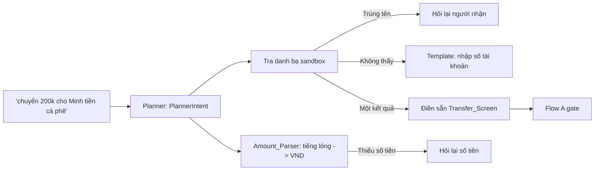

### F3 – Chia hóa đơn

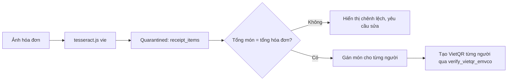

### F4 – Mua sắm an toàn

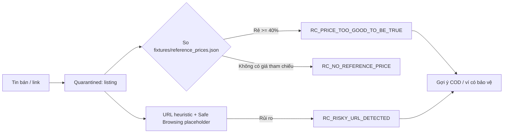

### F5 – Khuyến mãi thật hay giả

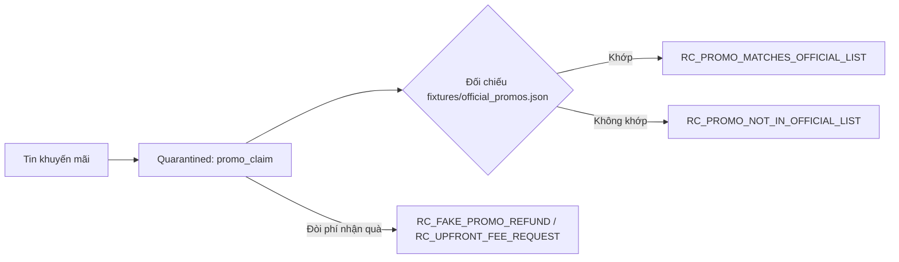

### F6 – Hỏi chi tiêu

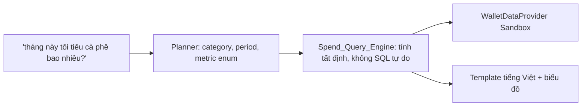

### F7 – Hóa đơn bất thường và gói định kỳ

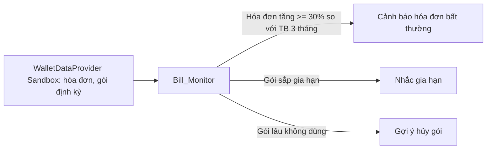

## 9. Bảng Thật / Sandbox

| Thành phần | Trạng thái |
|---|---|
| VietQR EMVCo TLV + CRC-16 + UTF-8 fallback | Thật |
| OCR tiếng Việt (tesseract.js) | Thật |
| Che PII (R1), pre-filter injection, kiểm tra URL heuristic | Thật |
| CaMeL Planner/Quarantined + AgentSpec R1–R6 + audit | Thật (LLM: Mock mặc định, Anthropic qua env, Bedrock stub) |
| Calm Shield, cooling-off, TTS, Context Elicitation | Thật |
| Mã hóa lại QR để mở app ngân hàng | Thật |
| Guardian_Extension (tiện ích Chrome MV3: bong bóng Shadow DOM, quét văn bản bôi đen hoặc văn bản trang) | Thật |
| NAPAS name inquiry | Sandbox |
| SIMO, GNN mule score, fan-in velocity | Sandbox |
| Lịch sử ví, danh bạ, hóa đơn, gói định kỳ | Sandbox |
| Flow A trên giao dịch MoMo thật | Không; chạy trên màn chuyển tiền mô phỏng |
| Google Safe Browsing | Placeholder qua env |

## 10. Bảng thuật ngữ

| Thuật ngữ | Giải thích |
|---|---|
| APP fraud | Authorized Push Payment fraud: nạn nhân tự tay chuyển tiền do bị lừa hoặc thao túng. |
| VietQR | Chuẩn mã QR thanh toán Việt Nam do NAPAS công bố, dựa trên EMVCo. |
| EMVCo | Tổ chức đặt chuẩn QR thanh toán; VietQR là biến thể áp dụng tại Việt Nam. |
| TLV | Tag-Length-Value: cấu trúc mã hóa trường dữ liệu trong payload QR EMVCo. |
| CRC-16 | Mã kiểm tra CRC-16/CCITT-FALSE ở tag 63 của QR; sai CRC nghĩa là payload bị sửa. |
| BIN | Bank Identification Number: mã định danh ngân hàng thụ hưởng trong VietQR. |
| NAPAS 247 | Hệ thống chuyển nhanh liên ngân hàng 24/7; name inquiry trả tên chủ tài khoản (sandbox trong dự án). |
| SIMO | Cơ sở dữ liệu tài khoản/SIM nghi ngờ mule; SIMO hit dẫn đến HARD_HOLD (R4). Sandbox. |
| GNN mule | Điểm `gnn_mule_score` từ mạng nơ-ron đồ thị phát hiện tài khoản trung gian; >= 0.85 là HARD_HOLD. Sandbox. |
| fan-in | Nhiều tài khoản cùng chuyển vào một tài khoản trong thời gian ngắn; dấu hiệu mule (`RC_FAN_IN_VELOCITY_HIGH`). |
| Tier ALLOW / SOFT_FRICTION / HARD_HOLD | Ba mức quyết định: cho phép; cảnh báo kèm bước xác nhận; chặn và cooling-off. |
| Reason code | Mã `RC_*` giải thích lý do của verdict; khai báo duy nhất trong `reason_codes.py`. |
| Stop code | Mã dừng của pipeline khi một bất biến bị vi phạm (xem mục 12). |
| cold-start | Người nhận lần đầu và không có ngữ cảnh; kết quả là `RC_COLD_START_NEEDS_CONTEXT`. |
| honesty invariant | Không bao giờ hiển thị "100% an toàn". |
| Context Elicitation | Hỏi người dùng ngữ cảnh giao dịch (cửa hàng, đơn online, người thân, cơ quan) để quyết định tiếp. |
| Calm Shield | Chế độ hiển thị trấn an: chữ lớn, nút "Tạm dừng & xác minh", timer, TTS chậm. |
| Fast Unblock | Mở nhanh giao dịch sau khi người dùng xác minh đủ (`RC_FAST_UNBLOCK_VERIFIED`). |
| structuring / Thông tư 50 | Chia nhỏ giao dịch để né ngưỡng báo cáo (9–10 triệu, tổng >= 20 triệu/24h); R5 nâng tối thiểu lên SOFT_FRICTION. |
| PII / Luật 91/2025 | Dữ liệu cá nhân (CCCD, CMND, SĐT, OTP, tên) phải che trước khi gọi LLM; chỉ lưu bằng chứng khi `explicit_consent_flag == True`. |
| CaMeL | Kiến trúc tách quyền: LLM tin cậy lập kế hoạch, LLM cô lập xử lý dữ liệu không tin cậy, code giữ quyền gọi tool. |
| P-LLM / Q-LLM | Privileged LLM (Planner) và Quarantined LLM (Extractor, không có tool). |
| taint | Dấu "nhiễm" của dữ liệu không tin cậy; dữ liệu taint không được điều khiển tool. |
| AgentSpec R1–R6 | Sáu luật runtime: R1 che PII, R2 không tra người nhận khi OCR chưa xác nhận, R3 pre-filter chỉ nâng SOFT, R4 SIMO/GNN là HARD, R5 structuring, R6 QR phải có `verify_vietqr_emvco`. |
| temporal stealth | Kẻ tấn công trải hành vi qua nhiều bước/thời điểm để né kiểm tra từng bước; R6 kiểm tra trace toàn cục. |
| circuit breaker | Ngắt Stage 2 sau 4.000 ms và dùng fallback an toàn. |
| progressive disclosure | Hiển thị kết quả theo từng stage, chi tiết mở khi cần. |
| pass^k | Chỉ số τ-bench: tỷ lệ kịch bản đạt cả k lần chạy độc lập. |
| agent harness | Khung chạy agent: LLMClient, tool runner, policy engine, audit. |
| eval harness | Bộ chạy fixture T01–T31, A01–A13 nhiều lần để tính pass^k. |
| Guardian_Extension | Tiện ích Chrome MV3 đóng vai lớp phủ desktop: bong bóng nổi trong Shadow DOM, lấy văn bản bôi đen hoặc văn bản hiển thị của trang và gửi tới Flow B. Không tự chuyển tiền, không đọc ngoài văn bản người dùng yêu cầu quét. |
| EXTENSION_SELECTION | ContentOrigin: văn bản người dùng bôi đen trên trang. Xử lý như PASTE (UNTRUSTED, ccount_origin = PASTE, qua che PII, pre-filter, Quarantined, R1–R6). |
| EXTENSION_PAGE_TEXT | ContentOrigin: văn bản hiển thị của cả trang do tiện ích lấy. Xử lý như PASTE; không bao giờ được coi là OCR nên không kích hoạt R2. |
| Shadow DOM | Cây DOM cách ly gắn vào một phần tử; bong bóng Guardian dùng nó để CSS và script của trang web không ảnh hưởng hoặc đọc được giao diện tiện ích. |
| sandbox provider | Cài đặt `RiskDataProvider` / `WalletDataProvider` dùng dữ liệu giả lập trong `fixtures/`. |

## 11. Danh sách Reason_Code

Bảng sinh từ `REGISTRY` trong `backend/guardian/reason_codes.py`, sắp xếp theo tier giảm dần rồi theo độ ưu tiên hiển thị.

| Mã (Reason_Code) | Tier tối thiểu | Cooling-off (giây) | Ý nghĩa (meaning_vi) |
|---|---|---|---|
| `RC_PROMPT_INJECTION_BLOCKED` | HARD_HOLD | 60 | Nội dung chứa câu lệnh cố điều khiển Guardian hoặc giả mạo khung điều khiển nội bộ. |
| `RC_QR_CHECK_BYPASS_DETECTED` | HARD_HOLD | 60 | Có QR nhưng trace thiếu bước verify_vietqr_emvco (luật R6). |
| `RC_VIETQR_TAMPERED_BAD_CRC` | HARD_HOLD | 60 | Mã QR VietQR có CRC sai, nghi bị sửa đổi. |
| `RC_SIMO_OR_MULE_HIGH_RISK` | HARD_HOLD | 60 | Tài khoản nhận trùng SIMO hoặc điểm GNN mule từ 0.85 trở lên. |
| `RC_FAN_IN_VELOCITY_HIGH` | HARD_HOLD | 60 | Số người gửi mỗi giờ vào tài khoản nhận vượt ngưỡng cấu hình. |
| `RC_FLOWB_FLAGGED_RECENTLY` | HARD_HOLD | 60 | Risk_Memory của phiên có mục chưa hết hạn cho tài khoản hoặc tên miền này. |
| `RC_UNOFFICIAL_APK_PHISHING` | HARD_HOLD | 60 | Liên kết tải APK, giả mạo cơ quan nhà nước hoặc kịch bản phishing/malware. |
| `RC_AUTHORITY_COERCION` | HARD_HOLD | 60 | Kịch bản mạo danh công an, cơ quan nhà nước, VNeID để ép chuyển tiền. |
| `RC_BANK_COACHING_DETECTED` | HARD_HOLD | 60 | Nội dung dặn nạn nhân cách trả lời ngân hàng, kèm kịch bản thuộc nhóm HARD. |
| `RC_URGENT_THIRD_PARTY_ACCT` | HARD_HOLD | 60 | Kịch bản giả người thân (deepfake) cần tiền gấp và đưa tài khoản của bên thứ ba. |
| `RC_REMOTE_SCREEN_TAKEOVER` | HARD_HOLD | 60 | Yêu cầu chia sẻ màn hình hoặc cài ứng dụng điều khiển từ xa, kèm kịch bản HARD. |
| `RC_FAKE_SHIPPER_RECALL` | HARD_HOLD | 60 | Kịch bản giả shipper đòi chuyển khoản để thu hồi hoặc hoàn đơn. |
| `RC_UNVERIFIED_INBOUND_RECEIPT` | HARD_HOLD | 60 | Người gửi tự nhận đã chuyển tiền bằng ảnh biên lai chưa được xác minh. |
| `RC_TASK_SCAM_UNLOCK_FEE` | HARD_HOLD | 60 | Lừa đảo việc làm nhiệm vụ online đòi nạp tiền hoặc phí mở khóa. |
| `RC_GUARANTEED_RETURN_PIG_BUTCHERING` | HARD_HOLD | 60 | Lừa đảo đầu tư hoặc tình cảm hứa lãi cao, cam kết không lỗ. |
| `RC_FAKE_PROMO_REFUND` | HARD_HOLD | 60 | Khuyến mãi không có trong danh sách chính thức và đòi phí trước. |
| `RC_BRAND_IMPERSONATION_MOMO` | HARD_HOLD | 60 | Chương trình mạo danh MoMo không khớp danh sách khuyến mãi chính thức. |
| `RC_CIRCULAR50_STRUCTURING_RISK` | SOFT_FRICTION | 30 | Dấu hiệu chia nhỏ giao dịch theo Thông tư 50 (luật R5). |
| `RC_ACCOUNT_SWAP_REQUEST` | SOFT_FRICTION | 30 | Nội dung yêu cầu đổi tài khoản nhận so với tài khoản người dùng đã nhập. |
| `RC_C2C_DEPOSIT_URGENCY` | SOFT_FRICTION | 30 | Người bán cá nhân đòi đặt cọc trước và hối thúc. |
| `RC_UPFRONT_FEE_REQUEST` | SOFT_FRICTION | 30 | Nội dung đòi trả phí hoặc đặt cọc trước. |
| `RC_CONTEXT_RELATIVE_URGENT_DECLARED` | SOFT_FRICTION | 30 | Người dùng khai báo đang chuyển gấp cho người thân. |
| `RC_CONTEXT_AUTHORITY_DECLARED` | SOFT_FRICTION | 60 | Người dùng khai báo cơ quan nhà nước yêu cầu chuyển tiền. |
| `RC_FAST_UNBLOCK_VERIFIED` | SOFT_FRICTION | 30 | Người dùng đã qua Fast Unblock (OTP sandbox và mục đích chuyển). |
| `RC_GREY_ZONE_RECIPIENT` | SOFT_FRICTION | 15 | Tài khoản nhận nằm trong vùng xám: GNN từ 0.6 đến dưới 0.85 hoặc tuổi dưới 30 ngày. |
| `RC_PRICE_TOO_GOOD_TO_BE_TRUE` | SOFT_FRICTION | 15 | Giá rao thấp hơn giá tham chiếu từ 40% trở lên. |
| `RC_PROMO_NOT_IN_OFFICIAL_LIST` | SOFT_FRICTION | 15 | Khuyến mãi không khớp danh sách chính thức và không đòi phí. |
| `RC_VIETQR_FOREIGN_OR_NON_VND` | SOFT_FRICTION | 15 | Mã QR của hệ thống nước ngoài hoặc không dùng VND. |
| `RC_VIETQR_INVALID_FORMAT` | SOFT_FRICTION | 15 | Mã QR sai định dạng VietQR. |
| `RC_SUSPECT_INJECTION_REVIEW` | SOFT_FRICTION | 15 | Điểm prefilter CPU từ ngưỡng mềm trở lên (luật R3 mức mềm). |
| `RC_RISKY_URL_DETECTED` | SOFT_FRICTION | 15 | URL có cờ rủi ro: TLD rủi ro, punycode, giống thương hiệu, rút gọn, IP hoặc Safe Browsing. |
| `RC_MANIPULATION_CUE_REVIEW` | SOFT_FRICTION | 15 | Nội dung có dấu hiệu thao túng tâm lý như hối thúc hoặc giữ bí mật. |
| `RC_SUSPICIOUS_UNCLASSIFIED` | SOFT_FRICTION | 15 | Nội dung đáng ngờ nhưng không khớp playbook nào. |
| `RC_LLM_OUTPUT_INVALID` | SOFT_FRICTION | 15 | Đầu ra LLM sai schema, bị từ chối, bị cắt hoặc không gọi tool. |
| `RC_LLM_TIMEOUT_FALLBACK` | SOFT_FRICTION | 15 | LLM quá thời gian chờ nên dùng kết quả dự phòng. |
| `RC_LLM_UNAVAILABLE_FALLBACK` | SOFT_FRICTION | 15 | LLM lỗi, chưa cài đặt hoặc circuit breaker đang mở. |
| `RC_PII_EGRESS_BLOCKED` | SOFT_FRICTION | 15 | Còn dữ liệu cá nhân sau khi che nên không gửi nội dung tới LLM (luật R1). |
| `RC_CONTEXT_ONLINE_ORDER_DECLARED` | SOFT_FRICTION | 15 | Người dùng khai báo đây là đơn hàng online. |
| `RC_COLD_START_NEEDS_CONTEXT` | SOFT_FRICTION | 0 | Người nhận lần đầu, không có lịch sử và không có tín hiệu rủi ro. |
| `RC_OCR_ACCOUNT_NEEDS_CONFIRM` | SOFT_FRICTION | 0 | Số tài khoản từ OCR chưa được người dùng xác nhận tên người nhận (luật R2). |
| `RC_TRUSTED_PAYEE_HISTORY` | ALLOW | 0 | Người nhận có lịch sử giao dịch và không có tín hiệu rủi ro. |
| `RC_CONTEXT_IN_STORE_DECLARED` | ALLOW | 0 | Người dùng khai báo đang thanh toán trực tiếp tại cửa hàng. |
| `RC_PROMO_MATCHES_OFFICIAL_LIST` | ALLOW | 0 | Khuyến mãi khớp danh sách chính thức còn hiệu lực. |
| `RC_NO_REFERENCE_PRICE` | ALLOW | 0 | Không có giá tham chiếu cho danh mục sản phẩm. |
| `RC_NO_SCAM_SIGNAL_FOUND` | ALLOW | 0 | Không phát hiện tín hiệu lừa đảo quen thuộc. |

## 12. Danh sách Stop_Code

Nguồn: `StopCode` trong `backend/guardian/schemas/enums.py`.

| Stop_Code | Ý nghĩa |
|---|---|
| `ABORT_WAIT_NAPAS_NAME_USER_CONFIRM` | R2: nguồn OCR chưa xác nhận, dừng tra rủi ro và chờ người dùng xác nhận tên/tài khoản. |
| `TEMPORAL_BYPASS_DETECTED_MISSING_VIETQR_CHECK` | R6: có QR payload nhưng trace thiếu `verify_vietqr_emvco`. |
| `LAW_91_CONSENT_REQUIRED` | Luật 91/2025: chưa có `explicit_consent_flag`, không được lưu bằng chứng. |
| `PII_EGRESS_BLOCKED` | R1: phát hiện PII chưa che trước khi gửi ra LLM, chặn lại. |

## 13. Lộ trình mobile

App mobile dùng chung backend; chỉ thay lớp thu nhận nội dung.

1. **Android share sheet:** người dùng chia sẻ tin nhắn, ảnh hoặc link sang Guardian bằng Share Intent; nội dung vào Flow B như dữ liệu UNTRUSTED. Bản web đã có tương đương qua PWA Web Share Target.
2. **NotificationListener (opt-in):** sau khi người dùng cấp quyền rõ ràng, Guardian đọc thông báo tin nhắn/ngân hàng để cảnh báo sớm. Chỉ xử lý cục bộ trước khi che PII, có công tắc tắt, và chỉ lưu khi có consent (Luật 91/2025).
3. **Bong bóng nổi `SYSTEM_ALERT_WINDOW` (đích Android):** hiển thị bong bóng Guardian trên mọi ứng dụng, giống bong bóng trên web. Quyền overlay cần người dùng bật thủ công. Trên desktop, lớp phủ này hiện do Guardian_Extension (tiện ích Chrome) đảm nhiệm, gửi nội dung với origin EXTENSION_SELECTION / EXTENSION_PAGE_TEXT; bong bóng Android là đích tiếp theo.
4. **iOS Share Extension:** iOS không cho overlay hay đọc thông báo của app khác, nên đường vào là Share Extension từ menu chia sẻ.
5. **Vì sao không dùng Accessibility Service:** quyền này đọc toàn bộ màn hình và có thể điều khiển thao tác. Đó là bề mặt tấn công lớn (malware lừa đảo hay lạm dụng đúng quyền này), Google Play hạn chế dùng cho mục đích không hỗ trợ người khuyết tật, và nó đi ngược nguyên tắc tối thiểu quyền và consent rõ ràng của Guardian.

## 14. Ranh giới bằng chứng (evidence boundary)

pass^3 = 100% trên MockLLM chỉ chứng minh Control Plane chạy đúng. Con số này không phải độ ổn định của LLM thật; phải đo lại khi bật Anthropic hoặc Bedrock. Mọi số liệu latency/chi phí trong spec PDF là mô phỏng trước triển khai.
| `RC_PROMPT_INJECTION_BLOCKED` | HARD_HOLD | 60 | Nội dung chứa câu lệnh cố điều khiển Guardian hoặc giả mạo khung điều khiển nội bộ. |
| `RC_QR_CHECK_BYPASS_DETECTED` | HARD_HOLD | 60 | Có QR nhưng trace thiếu bước verify_vietqr_emvco (luật R6). |
| `RC_VIETQR_TAMPERED_BAD_CRC` | HARD_HOLD | 60 | Mã QR VietQR có CRC sai, nghi bị sửa đổi. |
| `RC_SIMO_OR_MULE_HIGH_RISK` | HARD_HOLD | 60 | Tài khoản nhận trùng SIMO hoặc điểm GNN mule từ 0.85 trở lên. |
| `RC_FAN_IN_VELOCITY_HIGH` | HARD_HOLD | 60 | Số người gửi mỗi giờ vào tài khoản nhận vượt ngưỡng cấu hình. |
| `RC_FLOWB_FLAGGED_RECENTLY` | HARD_HOLD | 60 | Risk_Memory của phiên có mục chưa hết hạn cho tài khoản hoặc tên miền này. |
| `RC_UNOFFICIAL_APK_PHISHING` | HARD_HOLD | 60 | Liên kết tải APK, giả mạo cơ quan nhà nước hoặc kịch bản phishing/malware. |
| `RC_AUTHORITY_COERCION` | HARD_HOLD | 60 | Kịch bản mạo danh công an, cơ quan nhà nước, VNeID để ép chuyển tiền. |
| `RC_BANK_COACHING_DETECTED` | HARD_HOLD | 60 | Nội dung dặn nạn nhân cách trả lời ngân hàng, kèm kịch bản thuộc nhóm HARD. |
| `RC_URGENT_THIRD_PARTY_ACCT` | HARD_HOLD | 60 | Kịch bản giả người thân (deepfake) cần tiền gấp và đưa tài khoản của bên thứ ba. |
| `RC_REMOTE_SCREEN_TAKEOVER` | HARD_HOLD | 60 | Yêu cầu chia sẻ màn hình hoặc cài ứng dụng điều khiển từ xa, kèm kịch bản HARD. |
| `RC_FAKE_SHIPPER_RECALL` | HARD_HOLD | 60 | Kịch bản giả shipper đòi chuyển khoản để thu hồi hoặc hoàn đơn. |
| `RC_UNVERIFIED_INBOUND_RECEIPT` | HARD_HOLD | 60 | Người gửi tự nhận đã chuyển tiền bằng ảnh biên lai chưa được xác minh. |
| `RC_TASK_SCAM_UNLOCK_FEE` | HARD_HOLD | 60 | Lừa đảo việc làm nhiệm vụ online đòi nạp tiền hoặc phí mở khóa. |
| `RC_GUARANTEED_RETURN_PIG_BUTCHERING` | HARD_HOLD | 60 | Lừa đảo đầu tư hoặc tình cảm hứa lãi cao, cam kết không lỗ. |
| `RC_FAKE_PROMO_REFUND` | HARD_HOLD | 60 | Khuyến mãi không có trong danh sách chính thức và đòi phí trước. |
| `RC_BRAND_IMPERSONATION_MOMO` | HARD_HOLD | 60 | Chương trình mạo danh MoMo không khớp danh sách khuyến mãi chính thức. |
| `RC_CIRCULAR50_STRUCTURING_RISK` | SOFT_FRICTION | 30 | Dấu hiệu chia nhỏ giao dịch theo Thông tư 50 (luật R5). |
| `RC_ACCOUNT_SWAP_REQUEST` | SOFT_FRICTION | 30 | Nội dung yêu cầu đổi tài khoản nhận so với tài khoản người dùng đã nhập. |
| `RC_C2C_DEPOSIT_URGENCY` | SOFT_FRICTION | 30 | Người bán cá nhân đòi đặt cọc trước và hối thúc. |
| `RC_UPFRONT_FEE_REQUEST` | SOFT_FRICTION | 30 | Nội dung đòi trả phí hoặc đặt cọc trước. |
| `RC_CONTEXT_RELATIVE_URGENT_DECLARED` | SOFT_FRICTION | 30 | Người dùng khai báo đang chuyển gấp cho người thân. |
| `RC_CONTEXT_AUTHORITY_DECLARED` | SOFT_FRICTION | 60 | Người dùng khai báo cơ quan nhà nước yêu cầu chuyển tiền. |
| `RC_FAST_UNBLOCK_VERIFIED` | SOFT_FRICTION | 30 | Người dùng đã qua Fast Unblock (OTP sandbox và mục đích chuyển). |
| `RC_GREY_ZONE_RECIPIENT` | SOFT_FRICTION | 15 | Tài khoản nhận nằm trong vùng xám: GNN từ 0.6 đến dưới 0.85 hoặc tuổi dưới 30 ngày. |
| `RC_PRICE_TOO_GOOD_TO_BE_TRUE` | SOFT_FRICTION | 15 | Giá rao thấp hơn giá tham chiếu từ 40% trở lên. |
| `RC_PROMO_NOT_IN_OFFICIAL_LIST` | SOFT_FRICTION | 15 | Khuyến mãi không khớp danh sách chính thức và không đòi phí. |
| `RC_VIETQR_FOREIGN_OR_NON_VND` | SOFT_FRICTION | 15 | Mã QR của hệ thống nước ngoài hoặc không dùng VND. |
| `RC_VIETQR_INVALID_FORMAT` | SOFT_FRICTION | 15 | Mã QR sai định dạng VietQR. |
| `RC_SUSPECT_INJECTION_REVIEW` | SOFT_FRICTION | 15 | Điểm prefilter CPU từ ngưỡng mềm trở lên (luật R3 mức mềm). |
| `RC_RISKY_URL_DETECTED` | SOFT_FRICTION | 15 | URL có cờ rủi ro: TLD rủi ro, punycode, giống thương hiệu, rút gọn, IP hoặc Safe Browsing. |
| `RC_MANIPULATION_CUE_REVIEW` | SOFT_FRICTION | 15 | Nội dung có dấu hiệu thao túng tâm lý như hối thúc hoặc giữ bí mật. |
| `RC_SUSPICIOUS_UNCLASSIFIED` | SOFT_FRICTION | 15 | Nội dung đáng ngờ nhưng không khớp playbook nào. |
| `RC_LLM_OUTPUT_INVALID` | SOFT_FRICTION | 15 | Đầu ra LLM sai schema, bị từ chối, bị cắt hoặc không gọi tool. |
| `RC_LLM_TIMEOUT_FALLBACK` | SOFT_FRICTION | 15 | LLM quá thời gian chờ nên dùng kết quả dự phòng. |
| `RC_LLM_UNAVAILABLE_FALLBACK` | SOFT_FRICTION | 15 | LLM lỗi, chưa cài đặt hoặc circuit breaker đang mở. |
| `RC_PII_EGRESS_BLOCKED` | SOFT_FRICTION | 15 | Còn dữ liệu cá nhân sau khi che nên không gửi nội dung tới LLM (luật R1). |
| `RC_CONTEXT_ONLINE_ORDER_DECLARED` | SOFT_FRICTION | 15 | Người dùng khai báo đây là đơn hàng online. |
| `RC_COLD_START_NEEDS_CONTEXT` | SOFT_FRICTION | 0 | Người nhận lần đầu, không có lịch sử và không có tín hiệu rủi ro. |
| `RC_OCR_ACCOUNT_NEEDS_CONFIRM` | SOFT_FRICTION | 0 | Số tài khoản từ OCR chưa được người dùng xác nhận tên người nhận (luật R2). |
| `RC_TRUSTED_PAYEE_HISTORY` | ALLOW | 0 | Người nhận có lịch sử giao dịch và không có tín hiệu rủi ro. |
| `RC_CONTEXT_IN_STORE_DECLARED` | ALLOW | 0 | Người dùng khai báo đang thanh toán trực tiếp tại cửa hàng. |
| `RC_PROMO_MATCHES_OFFICIAL_LIST` | ALLOW | 0 | Khuyến mãi khớp danh sách chính thức còn hiệu lực. |
| `RC_NO_REFERENCE_PRICE` | ALLOW | 0 | Không có giá tham chiếu cho danh mục sản phẩm. |
| `RC_NO_SCAM_SIGNAL_FOUND` | ALLOW | 0 | Không phát hiện tín hiệu lừa đảo quen thuộc. |
